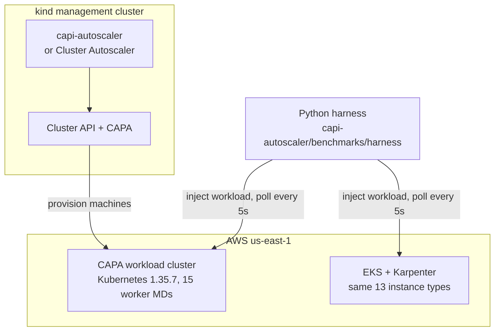
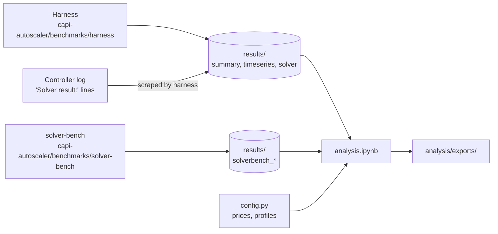

<div align="center">

# capi-autoscaler-research

**Benchmark data and analysis for [capi-autoscaler](https://github.com/wikoion/capi-autoscaler)**

[](LICENSE)
[](results/LICENSE)
[](analysis/pyproject.toml)
[](https://docs.astral.sh/uv/)
[](#dataset)

</div>

This repo holds the data and analysis behind my MSc Computer Science final project report, *Optimising Kubernetes Cluster Resource Utilisation with Constraint Programming Autoscaling* (September 2026). The autoscaler and the benchmark harness live in the main repo, pinned here as a submodule.

All of the numbers in the report are generated by a Jupyter notebook (`analysis/analysis.ipynb`). The capi-autoscaler is compared with CA and Karpenter on real AWS EC2 infrastructure across three profiles and three batch sizes. Placement-control analysis compares these runs with measurements collected before the placement-control feature was implemented.

## Contents

- [Research questions](#research-questions)
- [Key findings](#key-findings)
- [Experimental setup](#experimental-setup)
- [Methodology](#methodology)
- [Threats to validity](#threats-to-validity)
- [Dataset](#dataset)
- [Getting started](#getting-started)
- [Repository layout](#repository-layout)
- [Data dictionary](#data-dictionary)
- [Adding runs](#adding-runs)
- [Known issues](#known-issues)
- [Citation](#citation)
- [Licence](#licence)

## Research questions

The project's aim is to evaluate a novel, cloud-agnostic autoscaler for Kubernetes that uses the Google OR-Tools CP-SAT library to optimise node scale-up for unschedulable pods and optionally coordinates subsequent pod placement, improving resource utilisation over heuristic solvers while maintaining bounded scale-up time through a beam-search fallback.

| | Research question |
|---|---|
| RQ1 | Can CP-SAT-based node scale-up achieve better resource utilisation than the Kubernetes Cluster Autoscaler and Karpenter while producing feasible allocations for batches of up to 100 pods within a bounded time? |
| RQ2 | Within a fixed solve-time budget, how do solution quality and feasibility vary as the number of pending pods, candidate MachineDeployments and candidate node slots increase? |
| RQ3 | Does a bounded-width beam-search fallback provide acceptable solution quality when the solver hits its maximum solve time? |
| RQ4 | Does combining node scale-up optimisation with control over pod placements improve utilisation over provisioning-only autoscalers? |

## Key findings

**RQ1** is supported within the tested 25–100 pod range. All 90 capi-autoscaler runs completed within the benchmark timeout, and it achieves higher mean CPU utilisation and lower mean estimated fleet cost than Karpenter across the nine primary scenarios, while Karpenter retains a clear latency advantage. CA performs less efficiently in the tested configuration and times out in two heavy-constrained 100-pod runs. Consolidation narrows Karpenter's efficiency deficit, but the capi-autoscaler still has the lower mean fleet cost in all nine current consolidation comparisons without any post-provisioning draining required.

| Profile | System | 100-pod latency | Workers | CPU util. | Memory util. | Est. fleet rate |
|---|---|---:|---:|---:|---:|---:|
| Unconstrained | **capi-autoscaler** | 128.4 s | **24.0** | **84.0%** | **76.6%** | **$3.21/h** |
| Unconstrained | Karpenter | **66.7 s** | 27.5 | 69.1% | 64.8% | $5.38/h |
| Unconstrained | CA | 395.6 s | 47.4 | 46.5% | 52.3% | $7.03/h |
| Light-constrained | **capi-autoscaler** | 176 s | **24.9** | **82.5%** | 19.7% | **$3.07/h** |
| Light-constrained | Karpenter | **82.6 s** | 28.1 | 75.5% | **33.4%** | $3.94/h |
| Light-constrained | CA | 156.7 s | 29.0 | 68.5% | 31.8% | $4.20/h |
| Heavy-constrained | **capi-autoscaler** | 140.2 s | **26.6** | **80.7%** | **74.7%** | **$3.59/h** |
| Heavy-constrained | Karpenter | **80.5 s** | 38.2 | 59.4% | 57.7% | $4.83/h |
| Heavy-constrained | CA | 447.0 s (8/10, 2 timeouts) | 60.4 | 32.7% | 42.1% | $9.93/h |

<sub>Benchmark results from 10 end-to-end test sweeps for each autoscaler.</sub>

**RQ2** shows that solve time and feasibility depend jointly on pod count, candidate MDs and available slots. The live controller completes every solver attempt without leaving any pods unplaced, while the 243-run offline benchmark shows that larger search spaces can consume the full 30-second time budget.

**RQ3** shows that beam search is suitable as a bounded fallback rather than as an equivalent optimiser. It is extremely fast but loses solution quality and fails on the hardest 100-pod case.

**RQ4** is also supported, although less strongly because the provisioning-only baseline contains only two runs per scenario. Placement control reduces the mean fleet cost in every tested scenario, consistent with the hypothesis that optimised provisioning is more effective when pod placement is coordinated with the plan.

## Experimental setup

All benchmarks ran on real AWS EC2 instances in us-east-1. The capi-autoscaler and CA run on a Kind management cluster that also runs CAPI and CAPA controllers. The workload cluster is provisioned by the CAPI/CAPA controllers from `capi-autoscaler/benchmarks/manifests/capa-workload-cluster.yaml`: a single t3.medium control-plane node and 15 worker MachineDeployments of varying instance sizes, all pinned to Kubernetes v1.35.7 and resting at zero replicas. The MD pool spans 13 instance types across the m5/m6i general, c5 compute, r5 memory and t3 burstable families, from t3.medium (2 vCPU, 4 GiB) to r5.4xlarge (16 vCPU, 128 GiB), each annotated with Cluster Autoscaler-compatible capacity and min/max size annotations plus an hourly cost annotation. Three m6i.large pools pin failureDomain to us-east-1a/b/c respectively and label nodes with their zone, so new-node slots carry zone domains for the topology model.



The workload cluster runs Calico v3.28.0 in VXLAN mode, the AWS cloud controller manager, and a custom scheduler configuration scoring NodeResourcesFit with the MostAllocated strategy, so the default scheduler packs rather than spreads; this removes scheduler scoring policy as a confound between the packing-oriented solver and the baselines. The API server enables `MutatingAdmissionPolicy=true` with the `admissionregistration.k8s.io/v1beta1` runtime config, the only feature gate in the environment. A MachineHealthCheck remediates machines that never join, with deliberately generous 900-second timeouts.

### Systems under comparison

- **capi-autoscaler** is built from source, loaded into the management cluster and configured through an Autoscale resource: `podScaleUpDelay` 5s, `solverTimeout` 30s, `scanInterval` 10s, `unreadyNodeLimit` 5, `scalingTimeout` 10m, and `maxScaleOut` 40, set high so an entire scale-up commits in one batch, because the baselines have no batch limit and a lower cap would handicap only this system.
- **Cluster Autoscaler v1.35.2** runs on the management cluster with the clusterapi cloud provider, auto-discovering the same MachineDeployments as capi-autoscaler, with the least-waste expander and scale-down disabled to keep run measurements clean.
- **Karpenter 1.14.1** runs on an EKS 1.35.7 cluster, with a NodePool restricted to exactly the same 13 instance types, on-demand only, across the same three availability zones, and consolidation limited to WhenEmpty after 5 minutes. System pods run on a tainted managed node group excluded from measurement.
- **Karpenter with consolidation** is an optional fourth configuration. The NodePool disruption policy is set to WhenEmptyOrUnderutilized with a one-minute consolidateAfter for the duration of the run. Each run then holds the cluster for the full 900-second timeout window so that Karpenter has enough time to complete consolidations. These runs are recorded as a separate system (karpenter-consolidation) and are excluded from the RQ1 comparisons, which measure the scale-up event only.

Comparability is improved by giving each autoscaler access to the same instance types, timeouts and container resources, sharing one price table, and counting worker nodes in a way that excludes control-plane and tainted system nodes on both platforms.

### Workload profiles

Three profiles were each run at 25, 50 and 100 pods, providing nine scenarios per autoscaler. All pods use the pause:3.9 image with requests equal to limits, so that utilisation does not exceed requests.

1. **unconstrained:** a mix of nine pod classes (web, cache, pair, batch, db, api, memcache, standalone, filler) spanning 250m/256Mi to 2 CPU/16Gi requests, without any affinity rules.
2. **heavy-constrained:** identical class mix to unconstrained but with affinity rules: hostname self-anti-affinity (one per node) on web and standalone, zone affinity of cache to web plus hostname self-anti-affinity, hostname affinity of pair to web, zone anti-affinity of batch to db, zone self-affinity of db. The unconstrained/heavy-constrained pair differs only in rules, so their delta isolates the cost of constraint handling.
3. **light-constrained:** a topology-focused mix of four pod classes: zonespread (25% of pods), hostspread (15%), affinity (20%) and filler (40%). Zonespread (500m/512Mi) carries a zone topology spread constraint with maxSkew 1 and DoNotSchedule. Hostspread (500m/512Mi) carries the same constraint on hostname, keeping matching pod counts within a maxSkew of one across eligible nodes and making it the primary scaling driver of the profile. Both spread classes are pinned to the zoned m6i.large pools via required node affinity so the tainted control-plane node never counts as an empty spread domain. Affinity (1200m/2Gi) has required node affinity to c5.xlarge, c5.2xlarge, r5.xlarge or r5.2xlarge, with c5.4xlarge explicitly excluded. Filler (500m/512Mi) is unconstrained background load competing with the constrained classes for the same capacity. The profile is CPU-heavy relative to memory, roughly 1 CPU per GiB against the 1:4 ratio of the node pools, which is visible in its low memory-utilisation numbers.

Every run deploys the rendered manifests into a clean namespace against a cluster reset to zero workers, with the autoscaler redeployed. Runs time out after 900 seconds. The workload cluster is created fresh per benchmark session and torn down afterwards.

### Instance catalogue

| MD | Instance | vCPU | Memory | $/h | Max replicas |
|---|---|---:|---:|---:|---:|
| `small` | t3.medium | 2 | 4 GiB | 0.0416 | 10 |
| `medium` | m5.large | 2 | 8 GiB | 0.096 | 10 |
| `large` | m5.xlarge | 4 | 16 GiB | 0.192 | 10 |
| `general-xl` | m5.2xlarge | 8 | 32 GiB | 0.384 | 8 |
| `general-4xl` | m5.4xlarge | 16 | 64 GiB | 0.768 | 8 |
| `compute-l` | c5.xlarge | 4 | 8 GiB | 0.17 | 10 |
| `compute-xl` | c5.2xlarge | 8 | 16 GiB | 0.34 | 8 |
| `compute-4xl` | c5.4xlarge | 16 | 32 GiB | 0.68 | 4 |
| `memory-m` | r5.large | 2 | 16 GiB | 0.126 | 10 |
| `memory-l` | r5.xlarge | 4 | 32 GiB | 0.252 | 8 |
| `memory-xl` | r5.2xlarge | 8 | 64 GiB | 0.277 | 15 |
| `memory-4xl` | r5.4xlarge | 16 | 128 GiB | 1.008 | 8 |
| `zone-a` / `zone-b` / `zone-c` | m6i.large | 2 | 8 GiB | 0.096 | 15 each |

<sub>MD names drop the `bench-cluster-workers-` prefix.</sub>

## Methodology

### Metrics

Two collector threads poll every 5 seconds. The pod poller records time to first unschedulable pod, time to all pods scheduled, and time to all pods running. The primary latency metric is `latency_s`. It tracks the time taken between pod injection and all pods running. The node poller counts worker nodes (excluding control-plane and NoSchedule-tainted system nodes), sums allocatable and requested CPU and memory, and records counts per instance type. A run that never reaches all pods running within 900 seconds is recorded as `timed_out`.

Provisioning efficiency and utilisation are measured using the post-scheduling sample at which worker allocatable capacity was at its peak. This choice avoids treating any consolidation as if the capacity had never been provisioned. The metric should therefore be read as the capacity provisioned to satisfy the scale-up event, not as a long-running steady-state fleet size. Requested rather than consumed capacity is used because the benchmark does not simulate load across pods, so their runtime consumption is near zero.

Karpenter consolidation runs deliberately invert this decision because the question is what the fleet looks like once Karpenter has finished consolidating. Node count, utilisation and fleet cost are read from the final sample of the 900-second window rather than the peak. A settle time is also derived from the time series as the elapsed time until the last change in worker node count, which records how long the fleet took to stop changing size.

`cost_per_hour` is an estimated hourly rate calculated from the peak number of instances using a fixed us-east-1 price table. It is not AWS billing data and does not include other costs such as network traffic or control-plane instances. One deliberate pricing probe is included: r5.2xlarge is valued at a deliberately discounted benchmark rate of $0.277/h rather than $0.504/h on demand, and that value is also supplied to the capi-autoscaler's MachineDeployment annotation. This tests whether a cost-aware objective responds to an advantageous configured price. Karpenter is made aware of the same price through a NodeOverlay resource (an alpha feature that is enabled via the nodeOverlay feature gate), which overrides its provider on-demand price. The tested CA configuration cannot consume the benchmark price sheet. Both capi-autoscaler and Karpenter are therefore working from the same price sheet, with the only asymmetry being with CA.

Solver metrics (status, objective, unplaced count, beam usage and solve time) are scraped per attempt from the controller log after each CAPI autoscaler run.

### Offline solver experiments

The end-to-end benchmarks measure the controller and provisioning path, but they don't vary all dimensions named in RQ2 because of the time and cost requirements of running on real AWS infrastructure. They also do not force beam fallback as the primary solver. Two offline replay suites were therefore added using the same optimiser code and workload/profile generators as the cluster harness. These experiments isolate algorithm behaviour from EC2 provisioning and scheduler timing while preserving the model structure used by the CAPI autoscaler.

- **RQ2:** the offline benchmarks run a factorial sweep over three workload profiles, pod counts of 25, 50 and 100, MachineDeployment counts of 5, 10 and 15, and three pre-defined maximum candidate slot ceilings (low, medium and high). Each of the 81 cells is repeated three times using the production CP-SAT configuration, providing 243 solves in total. The recorded outcomes are mean and maximum wall-clock optimisation time, full-placement fraction, mean unplaced pods, solver status and estimated fleet rate. The low-slot level is capacity constrained in some large cases, so feasibility degradation is observable rather than hidden by a generous slot ceiling.
- **RQ3:** another suite replays identical instances across five configurations: beam-only and CP-SAT with 1-, 2-, 10-, and 30-second budgets. Each profile and pod count are run three times, resulting in 135 solves. For solutions in which every pod was placed, quality is expressed as the objective gap to the best fully placed solution observed for the same instance. Incomplete solutions are counted against the full placement rate and are excluded from the objective gap comparison. This prevents artificially cheap-seeming partial placements from being interpreted as a better fleet.
- **Consolidation headroom:** a third suite solves heavy-constrained at 100 pods with 15 MDs at the production 30-second time budget and at a 600-second time budget. The intent of this run is to compare solution quality between a shorter time bound appropriate for scale-up and a longer time bound appropriate for scale-down consolidation.

### Statistical treatment and data hygiene

Results are summarised as means with 95% t-distribution confidence intervals over completed runs. Runs that timed out are excluded from means, but are always counted and reported. Confidence intervals are used to indicate the uncertainty around means, not to make formal claims of statistical significance. To avoid overstating small differences, percentage differences between systems are only reported when the separately calculated 95% confidence intervals do not overlap.

All retained run files in `results/` are pooled into the analysis. Outdated or invalid sessions are moved to `results/archive/`. The capi-autoscaler runs are either assigned to provisioning-only or placement-control cohorts from their file date. Only placement-control comparisons are used to compare against the other two autoscalers. The earlier provisioning-only cohort is only used for the RQ4 pre/post comparison. The code and configuration were designed to differ only in whether placement control was enabled. However, because the two cohorts were collected at different times, the comparison cannot be treated as a fully randomised experiment.

### Benchmark validity controls

Several environmental failures were encountered and fixed before the retained dataset was collected. Calico in its default BGP full-mesh configuration would fail to converge reliably when approximately 20 nodes joined simultaneously. This would leave nodes in a NotReady state for several minutes. The benchmark was therefore moved to VXLAN mode. Pulling images from docker.io anonymously encountered rate limiting, so the benchmark images were moved to quay.io. MachineHealthChecks were raised to 900 seconds to match the benchmark harness timeout so that they could not remediate nodes during a run. Finally, an 8 GiB control-plane root volume filled during repeated runs and evicted the cloud-controller manager, so it was increased to 40 GiB.

## Threats to validity

- **Sample size:** The main comparison has ten attempted runs per scenario, but the provisioning-only and Karpenter-consolidation cohorts only contain two. Confidence intervals are therefore descriptive rather than formal significance tests, and two CA heavy-constrained 100-pod runs timed out and are therefore not included in the means.
- **Platform differences:** Karpenter provisions directly through its AWS provider on EKS, while the other systems provision through CAPI/CAPA. Instance types, zones and Kubernetes versions are aligned, but the provisioning paths are not, so latency differences include overheads introduced by CAPI as well as autoscaler behaviour.
- **Pricing:** capi-autoscaler and Karpenter use the same benchmark price sheet, including the discounted r5.2xlarge value, while the tested CA configuration cannot consume that price information. Dollar-cost comparisons against CA therefore contain a pricing asymmetry. Utilisation and worker count provide less price-dependent measures of packing.
- **Synthetic workloads:** Pause containers with requests equal to limits isolate scheduling and provisioning behaviour but omit application startup, workload churn, stateful behaviour and PodDisruptionBudgets.
- **Offline experiments:** RQ2, RQ3 and the scale-down headroom experiment use the production optimiser but replay generated instances outside a running cluster. They isolate solver behaviour but do not include provisioning delays, scheduler races or changes in live cluster state.
- **Placement-control cohort:** Pre- and post-placement-control results were collected at different times rather than through randomised interleaving. The observed improvement supports the mechanism but cannot establish a precise causal effect size.
- **Configuration scope:** The scheduler uses MostAllocated, CA uses the least-waste expander, and the consolidation experiment uses one Karpenter disruption policy. Results therefore characterise these tested configurations rather than every possible Kubernetes or autoscaler configuration.

## Dataset

| Autoscaler | Cohort | Runs |
|---|---|---:|
| capi-autoscaler | placementcontrol | 90 |
| capi-autoscaler | pre-placementcontrol | 18 |
| Cluster Autoscaler | baseline | 90 |
| Karpenter | baseline | 90 |
| Karpenter with consolidation | baseline | 18 |
| **Total** | | **306** |

Offline solver benchmark: 243 rows for `rq2`, 135 for `rq3` and 6 for `rq4`. There are also 173 per-solve records from capi-autoscaler runs.

> [!NOTE]
> `results/` is the dataset the report was written from. Two capi-autoscaler runs made after the report, `benchmark_20260908_204211` and `benchmark_20260918_124547`, are kept in `results/archive/post-report-20260918/`.

## Getting started

```sh
git clone --recurse-submodules git@github.com:wikoion/capi-autoscaler-research.git
cd capi-autoscaler-research/analysis
uv sync
uv run jupyter lab analysis.ipynb
```

Regenerate every figure and table headless:

```sh
uv run jupyter nbconvert --to notebook --execute --inplace analysis.ipynb
```

Figures (SVG and PNG), tables (CSV and Markdown) and summaries are written to `analysis/exports/`. More detail is in [analysis/README.md](analysis/README.md).

## Repository layout

```
.
├── analysis/
│   ├── analysis.ipynb           # the notebook behind the report
│   ├── capi_bench_analysis/     # loading, stats, plotting, export
│   └── tests/
├── results/
│   ├── *_summary.csv            # one row per run
│   ├── *_timeseries.csv         # one row per 5s poll
│   ├── *_solver.csv             # one row per solve, capi-autoscaler only
│   ├── solverbench_*_rq{2,3,4}.csv
│   └── archive/                 # kept, excluded from the analysis
└── capi-autoscaler/             # submodule: harness config and solver log format
```



## Data dictionary

Harness files are named `<prefix>_<YYYYMMDD_HHMMSS>_<kind>.csv`. `<prefix>` is the harness `--output-prefix`, such as `benchmark` or `placement9` to `placement12`. Per-run values in `*_summary.csv` are taken at the peak-allocatable sample described in [Metrics](#metrics), or the final sample for consolidation runs.

### `*_summary.csv`

| Column | Description |
|---|---|
| `autoscaler` | `capi-autoscaler`, `cas`, `karpenter` or `karpenter-consolidation` |
| `scenario`, `profile`, `pod_count` | e.g. `heavy-constrained-100`, `heavy-constrained`, `100` |
| `run_num`, `run_id` | Run number in the batch, and a unique run ID |
| `first_unschedulable_s` | Seconds from pod injection to the first unschedulable pod |
| `all_scheduled_s` | Seconds until every pod was scheduled |
| `all_running_s`, `latency_s` | Seconds until every pod was running. `latency_s` is the same value |
| `worker_nodes` | Worker nodes |
| `workload_cpu_util_pct`, `workload_mem_util_pct` | Requested over allocatable on worker nodes |
| `cost_per_hour` | Estimated fleet rate from the instance catalogue prices |
| `instance_counts` | Count per instance type |
| `timed_out` | True if the pods weren't all running within 900 seconds |

### `*_timeseries.csv`

One row per 5 second poll: `elapsed_s`, `ready_nodes`, `worker_nodes`, `pending_pods`, `scheduled_pods`, `running_pods`, `workload_cpu_requested_m`, `worker_cpu_allocatable_m`, `workload_mem_requested_mi` and `worker_mem_allocatable_mi`, keyed by `autoscaler`, `scenario` and `run_id`.

### `*_solver.csv`

One row per CP-SAT solve, from the controller log: `attempt`, `status`, `objective`, `unplaced`, `used_beam` and `solve_time_secs`, keyed by `autoscaler`, `scenario` and `run_id`.

## Adding runs

1. Run the benchmarks from the main repo. See its README.
2. Copy the new CSVs from `capi-autoscaler/benchmarks/results/` into `results/`.
3. To leave a file out, move it to a dated subdirectory under `results/archive/` that says why. To drop one run, add it to `EXCLUDED_RUN_IDS` in the notebook's first cell.
4. If the harness config changed, bump the submodule to the commit the runs used.
5. Re-run the notebook.

## Known issues

> [!WARNING]
> mermaid-cli 12 dropped the `-w` option, and `capi_bench_analysis/export.py` passes `-w 1600` when it renders the architecture diagrams to PNG. With mermaid-cli 12 the first code cell fails and the architecture PNGs aren't written. Everything else still runs.

## Citation

```bibtex
@mastersthesis{draycott2026capiautoscaler,
  author = {Draycott, Richard},
  title  = {Optimising Kubernetes Cluster Resource Utilisation with Constraint Programming Autoscaling},
  school = {School of Computer Science, University of Hertfordshire},
  type   = {MSc Computer Science Final Project Report},
  year   = {2026},
  month  = {sep}
}
```

## Licence

| Path | Licence |
|---|---|
| `analysis/` | Apache-2.0, see [LICENSE](LICENSE) |
| `results/` | CC BY 4.0, see [results/LICENSE](results/LICENSE) |
| `capi-autoscaler/` | Its own licence |
